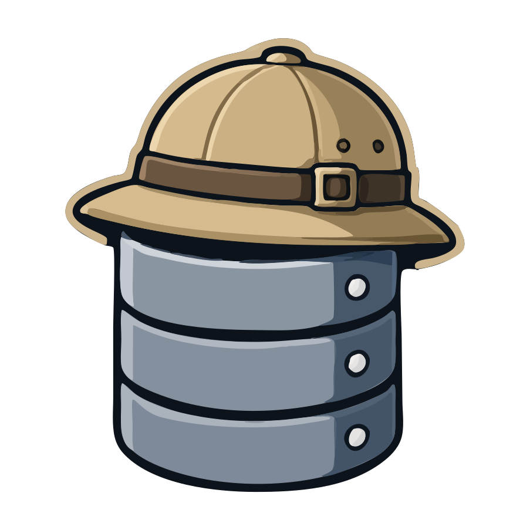
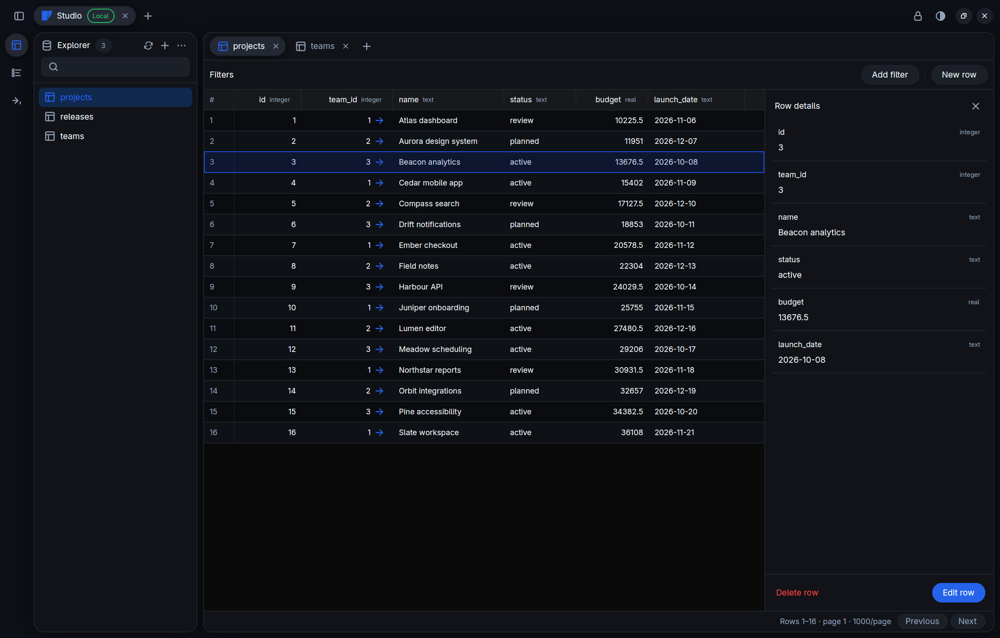
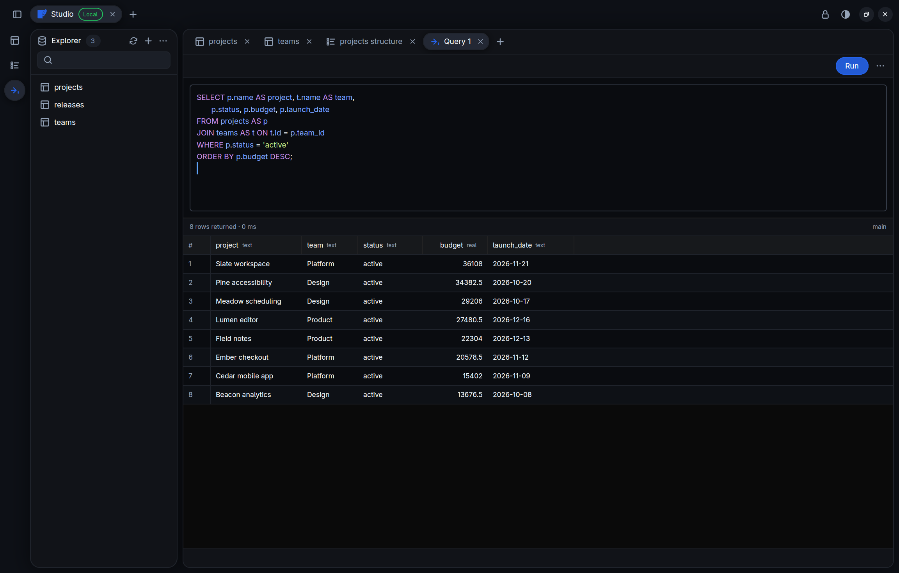

<p align="center">
  
</p>

<h1 align="center">DBX</h1>
<p align="center">A safety-first native database workbench for Linux and macOS.</p>
<p align="center">PostgreSQL · MySQL · SQLite · Redis · MongoDB · CockroachDB · DuckDB · Elasticsearch · BigQuery · Kafka · Turso · Cloudflare D1 · ClickHouse · SQL Server · Snowflake</p>

Browse your data, follow relationships, edit rows, and run queries in a responsive desktop app. DBX uses [GPUI](https://github.com/zed-industries/zed/tree/main/crates/gpui) for its window, input, and GPU rendering.



**DBX is in active development.** It is runnable today, but should not yet be treated as a production database administration tool. Start with a disposable database and a least-privilege account.

## Inside the workbench

- **Fifteen database connectors:** SQL databases, document stores, Elasticsearch indices and Kafka topics, with provider-specific editors and bounded browsing. See the [connector guide](docs/database-connectors.md) for connection formats and supported operations. Supabase connects through PostgreSQL.
- **A tabbed workspace:** simultaneous connections, independent table/query/structure tabs, and a searchable schema explorer.
- **Data you can work with:** virtualized grids over bounded row pages, server-side header sorting, structured filters, foreign-key navigation, and an all-field row inspector with JSON and binary previews.
- **Explicit edits:** typed insert/update drafts, inline cell editing with staged Save/Discard, Value/NULL/Default states, primary-key-guarded updates and deletes, staged undo/redo and bulk edits, and confirmations for truncate/drop (type the table name on production connections).
- **A query editor:** syntax highlighting, SQL completion, optional [Vim bindings](docs/user-guide.md#vim-bindings), separate statement results, saved queries, find/replace, SQL parameter prompts, encrypted tab recovery, Markdown/XLSX loaded-result exports, streaming full-query/table XLSX exports, shareable `.sql` files and favourites, and per-connection query history. Native SQL tabs retain their own transaction sessions.
- **Bring your own query assistant:** use OpenAI or Anthropic with a vault-stored API key, a local Ollama model, or Claude, Cursor, Codex, OpenCode and GitHub Copilot CLIs. Generated SQL is a draft you review and run yourself. See [agent setup](docs/query-agents.md).
- **Import and export:** streamed SQL, CSV, and TSV transfers with progress and cancellation; atomic imports and snapshot exports on supported engines. Database exports include table selection, gzip, and schema-only SQL options. See [workbench safety and limits](docs/workbench-safety.md).
- **Database diagnostics:** execution-plan views and comparisons, PostgreSQL/MySQL session and lock queries, protected connection profiles, and reviewable schema comparison drafts.
- **Saved connections:** named profiles and folders, production window tint, colour-coded tags, connection testing, and encrypted credentials in the DBX Vault. Import from TablePlus, DBeaver, Docker Compose or `.env` files, or open a SQLite path/database URI from the terminal.
- **A visual table designer:** add, rename or drop columns and add or drop indexes through a reviewable SQL draft.
- **Cloud authentication helpers:** fetch AWS RDS IAM or Azure PostgreSQL Entra tokens from an authenticated local CLI.
- **Socket and SSH connections:** local Unix sockets and SSH forwarding to TCP endpoints or remote sockets for PostgreSQL, MySQL, and Redis.
- **Custom themes:** ten palettes with light, dark, and system appearance; edit every colour in Settings → Appearance, import VS Code or Zed JSON/JSONC themes, or export a reusable DBX theme. [Theme guide](docs/themes.md).

### Write SQL, see the results



Screenshots show the real Linux application with fictional SQLite demo data and reduced transparency enabled. macOS uses its native window controls.

## Build from source

### Prerequisites

- **Rust 1.97 or newer**, with Cargo. The minimum version is declared in [Cargo.toml](Cargo.toml).
- **Git**, a native C/C++ build toolchain, and **CMake** for native dependencies.
- **macOS:** Xcode and its command-line tools, including the Metal tooling required by GPUI. Open Xcode once to complete setup, then check `xcode-select -p`. See [GPUI/Zed's macOS build guide](https://zed.dev/docs/development/macos) for current platform requirements.
- **Linux:** a Wayland or X11 desktop, a working Vulkan driver, `pkg-config`, and development libraries for XCB, xkbcommon, and fontconfig. Distribution package names vary; [Zed's Linux dependency guide](https://zed.dev/docs/development/linux) is a useful reference for GPUI's platform dependencies. A desktop file portal is needed for native file dialogs.
- **Optional:** Docker Compose for the disposable database integration suite; Python 3 for the Linux UI fixtures.

```bash
git clone https://github.com/jrmd/dbx.git
cd dbx

rustup toolchain install stable
rustup override set stable
```

The first build fetches the GPUI and gpui-component Git dependencies and compiles the native stack, so allow extra time and disk space.

### Linux

```bash
# Build and launch the app with the fast local profile.
make linux-run

# Or stage a distributable directory and archive (shipping release profile).
make linux-build

# Build a single-file AppImage.
make linux-appimage
```

`make linux-build` produces:

- `target/linux/DBX/usr/bin/dbx`
- Desktop metadata and the SVG icon under `target/linux/DBX/usr/share/`
- `target/linux/DBX-VERSION-linux-x86_64.tar.gz` and its `.sha256` checksum

The archive contains a Linux staging tree. The destination machine still needs compatible system libraries and graphics drivers. The shipping Cargo binary is `target/release/dbx`; `make linux-run` and the other local targets below build `target/release-local/dbx`.

`make linux-appimage` also produces `target/linux/DBX-VERSION-linux-x86_64.AppImage` and its checksum. It uses the host's X11/Wayland, xkbcommon, Vulkan driver, and fonts. The first run downloads [appimagetool](https://github.com/AppImage/appimagetool) into `target/linux/tools/`. Build on an older distribution, as the release workflow does on Ubuntu 22.04, so the AppImage runs on systems with older glibc.

The AppImage updates itself in place when its file is in a writable directory.
For a user-owned install from the release tarball that supports in-app updates, extract the tarball
and copy its `usr/` contents into `~/.local/` (binary, desktop file, and icon).
The app needs a writable installation directory to update itself. System package
installs should be updated through their package manager.

### Updates and GitHub releases

DBX checks stable [GitHub releases](https://github.com/jrmd/dbx/releases) on launch
and every six hours. Open **Settings** to install an available version and read
its release notes. Downloads show byte progress, retry transient failures up to
three times, and are verified against the release SHA-256 checksum before
replacement. macOS also requires the same Apple signing team and Gatekeeper
acceptance. Installation keeps the current session open. **Restart DBX** closes
open sessions; finish your work before clicking it. You can also use **Check for
Updates…** in the native Mac app menu. Set `DBX_DISABLE_UPDATES=1` to disable
background checks (useful for development, QA, and package-managed installs).
Update checks first use an installed GitHub CLI (`gh`) and its existing authentication
so they can use GitHub's authenticated API allowance. If `gh` is missing, fails,
or times out, DBX falls back to the public GitHub API. On macOS it also checks
standard Homebrew locations when the desktop launcher's PATH omits them. Archive
downloads and checksum/signature validation follow the same verification process.

Failures appear in Settings with a notification even if the dialog is closed.
The app distinguishes checksum download, archive download, verification, and
installation so a failed attempt can be diagnosed without guessing its stage.

### Unix sockets and SSH tunnels

For PostgreSQL, MySQL, or Redis, enable **Use Unix socket** in the connection
form. Enter an absolute directory for PostgreSQL (for example,
`/var/run/postgresql`); its database port selects `.s.PGSQL.PORT` inside that
directory. MySQL and Redis take an absolute socket file path. The database host
is ignored in socket mode. SQLite continues to use a local database file.

Enable **Connect through SSH tunnel** and enter the SSH host, port, and username.
Leave the key field blank to use your existing OpenSSH agent/config, or choose
a private key file. Optional jump hosts accept comma-separated `[user@]host[:port]` hops. Load encrypted keys into your agent first. DBX uses key/agent
authentication, or the masked SSH password field. Passwords are encrypted with the database credential. Forwarding reconnects after its SSH process exits; database writes are never replayed. Connect to a new SSH
host from a terminal first to verify and save its host key. DBX refuses unknown
or changed host keys and binds forwarding only on loopback. This follows
[OpenSSH's forwarding and authentication behavior](https://man.openbsd.org/ssh).

The database host/port are interpreted from the SSH server. Enabling both socket
and SSH modes forwards to a socket on that server. Test Connection, Connect,
and saved profiles use the same settings; the tunnel closes when its engine is
released. TLS options are retained. On Unix, strict PostgreSQL/MySQL TLS over SSH
uses a local socket for forwarding while preserving the original server name for
certificate verification. Native PostgreSQL tools use libpq host/hostaddr separation.
Certificates and trusted SSH host keys are still required. See the
[task guide](docs/user-guide.md) and [capability matrix](docs/capability-matrix.md).

Maintainer releases are built locally on an Apple Silicon Mac: `make release`
builds signed, notarized macOS bundles plus Linux x86_64 packages in an Ubuntu
22.04 Docker container, with persistent build caches. `make release-publish`
uploads and verifies all assets before publishing the complete release. Intel
Macs are not supported. Fast CI and database checks remain automatic; hosted
release workflows are manual fallbacks and tag pushes do not launch builds.
Run `make release-doctor` to check setup and see the
[release guide](docs/macos-release.md) for signing credentials and commands.

### macOS

After installing Xcode and launching it once, prepare the toolchain:

```bash
xcode-select --install
sudo xcode-select --switch /Applications/Xcode.app/Contents/Developer
brew install cmake
```

The command-line tools installer may report they are already installed. If GPUI reports that `metal` is missing, follow the [Metal toolchain troubleshooting steps](https://zed.dev/docs/development/macos#troubleshooting) before rebuilding.

```bash
# Build DBX.app and sign it with your installed Apple certificate.
make build

# Build, sign, and open it.
make run

# Build and replace /Applications/DBX.app.
make install
```

The bundle is `target/macos/DBX.app`, including its Finder icon. `make install` quits DBX and replaces the installed copy. To install somewhere else:

```bash
mkdir -p "$HOME/Applications"
make install INSTALL_DIR="$HOME/Applications"
```

For terminal logs, use `DBX_FOREGROUND=1 make run`. `make macos-build` and `make macos-run` are aliases for `make build` and `make run`. Prefer this bundle workflow on Mac so rebuilds retain a consistent signing identity. `make cargo-build` and `make cargo-run` are also available for the raw Cargo workflow.

### Local builds and production builds

`make build`, `make run`, `make install`, `make linux-run`, `make cargo-build` and `make cargo-run` use the `release-local` Cargo profile: optimised, with LTO off, parallel code generation and incremental compilation. The first build compiles the native stack into a separate cache; the main saving comes on subsequent builds after an edit. This trades some runtime optimisation and binary size for build speed. The binary lands in `target/release-local/`.

Production binaries use the `release` profile, which is also what the release scripts use directly:

```bash
cargo build --locked --release --package dbx-ui
```

`make linux-build`, `make linux-package`, `make linux-appimage`, `scripts/build-macos-app.sh` and `scripts/release-macos.sh` default to `release`. `scripts/release-macos.sh` always pins `release`, ignoring any inherited `DBX_CARGO_PROFILE`. To choose a profile explicitly, set `DBX_CARGO_PROFILE` (for example `make run DBX_CARGO_PROFILE=dev` for an unoptimised `target/debug` build). The helper scripts honour `CARGO_TARGET_DIR`, but not a `build.target-dir` set in Cargo config.

## Your own Mac signing key

**You do not need the maintainer's signing key to build and run DBX on your Mac.** For maintainer-signed releases, see the [local release guide](docs/macos-release.md). Release publication requires both platform builds and validation to succeed.

`make build`, `make run` and `make install` use [the Mac build helper](scripts/build-macos-app.sh), which signs the bundle with identifier `dev.jrmd.dbx` using a real certificate already installed in your login keychain. It prefers a **Developer ID Application** certificate and otherwise uses an **Apple Development** certificate (a free Apple Account works: add one in Xcode under **Settings → Accounts → Manage Certificates**). The identity is chosen by SHA-1 fingerprint and checked before the long Cargo build starts. macOS may ask you to unlock the keychain or allow `codesign` to use the key.

The helper never silently creates a certificate. If no suitable identity is installed, or several match, the build stops and tells you what to do. Keep using the same identity: it helps preserve access to the Keychain item used by **Unlock automatically on this device**, and switching certificates or using ad-hoc signatures may cause new access prompts. The signing key is separate from your vault passphrase and database credentials.

Check the available identities and the finished bundle:

```bash
security find-identity -v -p codesigning "$HOME/Library/Keychains/login.keychain-db"
codesign --verify --deep --strict --verbose=2 target/macos/DBX.app
```

### Choosing an identity

| Setting | Effect |
| --- | --- |
| `DBX_SIGNING_NAME="Apple Development: Name (TEAMID)"` | Use this installed identity. A SHA-1 fingerprint also works, which resolves several certificates with the same name. |
| `DBX_KEYCHAIN=/path/to/keychain-db` | Search and sign with this keychain instead of the login keychain. |
| `DBX_SIGNING_MODE=apple-development` | Require an Apple Development identity. |
| `DBX_SIGNING_MODE=developer-id` | Require a Developer ID Application identity (see below). |
| `DBX_SIGNING_MODE=local` | Opt in to a self-signed identity (`DBX Local Development`, or `DBX_SIGNING_NAME`) that is created in the keychain if missing. |
| `DBX_SIGNING_NAME=-` | Opt in to ad-hoc signing without a certificate. Keychain access may need renewed approval after rebuilds. |

For example:

```bash
DBX_SIGNING_NAME="Apple Development: Name (TEAMID)" make run

DBX_SIGNING_MODE=local make run
```

### If you have no certificate

Add an Apple Development certificate in Xcode, or opt in to a self-signed one with `DBX_SIGNING_MODE=local make run`. If automatic creation fails, create it once in **Keychain Access**: choose **Certificate Assistant → Create a Certificate**, name it `DBX Local Development`, set **Identity Type** to **Self Signed Root** and **Certificate Type** to **Code Signing**, save it in the **login** keychain with its private key, then run `DBX_SIGNING_MODE=local make run` again.

### Distributing a Mac build to other people

The local build helper does **not notarize** the app. Passing `codesign --verify` checks the signature's integrity; it does not mean Gatekeeper will accept a downloaded app.

For distribution under your own identity, obtain a **Developer ID Application** certificate through your Apple Developer Program account, install it together with its private key, sign the app with the hardened runtime and a secure timestamp, then submit it for notarization and staple the accepted ticket. See [Apple's Developer ID certificate instructions](https://developer.apple.com/help/account/certificates/create-developer-id-certificates) and [notarization workflow](https://developer.apple.com/documentation/security/customizing-the-notarization-workflow).

Use `DBX_SIGNING_MODE=developer-id` (optionally with `DBX_SIGNING_NAME`) for distribution builds: this requires an existing Developer ID Application identity, rejects Apple Development, ad-hoc and self-signed identities, never creates a replacement, and adds secure timestamps. The [local release command](docs/macos-release.md) also notarizes and staples the bundle, verifies Gatekeeper acceptance, and produces the release ZIP and checksum. Do not share or commit your private key or certificate export.

## First connection

1. Create a DBX Vault with a passphrase. Keep it somewhere safe: DBX cannot recover it.
2. Choose your database provider, or paste a connection URL to detect it. Add a connection name, a tag, and connection details; for SQLite or DuckDB, choose a database file. The [connector guide](docs/database-connectors.md) covers cloud tokens and query examples.
3. Test the connection, save it if desired, and connect.
4. Open a table, inspect a row, or create a query tab. Review the target connection before applying writes.

Saved profile metadata is password-free JSON in the platform configuration directory. Credentials are encrypted in the app-owned vault with Argon2id and XChaCha20-Poly1305. Optional device unlock stores the derived vault key in macOS Keychain or Linux Secret Service; it never stores your passphrase. Importing old system passwords is an explicit action.

## Development and checks

```bash
cargo fmt --all -- --check
cargo clippy --locked --workspace --all-targets --all-features -- -D warnings
cargo test --locked --workspace

# Disposable connector tests (requires Docker Compose).
./scripts/test-integration.sh

# Live local socket and SSH checks (Docker and OpenSSH client/server required).
python3 scripts/test-transports.py

# Isolated native UI session (Linux; requires Python 3).
./scripts/run-ui-test.sh
```

The integration script starts PostgreSQL 16, MySQL 8.4, MariaDB 11.4, Redis 7, ClickHouse 26.8, MongoDB 8, CockroachDB 25.1, Elasticsearch 8.17, Kafka 3.9, and SQL Server 2022 on loopback-only ports, uses temporary SQLite storage, runs the integration, workbench-safety, and connector tests serially, repeats the MySQL tests against MariaDB with MariaDB's client tools, and tears down its containers. The live-database workflow is configured to run the same suite on pull requests and nightly. `DBX_TEST_POSTGRES_URL`, `DBX_TEST_MYSQL_URL`, `DBX_TEST_MARIADB_URL`, `DBX_TEST_REDIS_URL`, and `DBX_TEST_SQLITE_URL` override its defaults; point them only at disposable databases because the tests perform writes. Defaults use the loopback ports in `docker-compose.test.yml`. Set `DBX_TEST_<ENGINE>_PORT` and `DBX_TEST_COMPOSE_PROJECT` to run alongside another test stack; the script derives its disposable URLs from those ports. Connector URL overrides are also available for all server tests.

The native UI launcher keeps its test vault, profiles, and database under `target/ui-test/`, separate from normal user configuration. See [desktop QA](docs/desktop-qa.md) for fixture credentials and platform checks, and [architecture](docs/architecture.md) for the core/UI boundaries.

## Scope and safety

DBX is a client, not a database privilege boundary. GUI filters and row changes use bound parameters and quoted identifiers. Raw SQL and Redis commands execute with your connection's privileges. Use least-privilege accounts and review destructive actions.

Browsing is paged and bounded; grid virtualization does not imply loading an entire database. Table creation starts from an engine-aware SQL template. MongoDB documents and Redis values have separate structured editors with review and conflict checks; their native command consoles remain available. Schema comparison generates a conservative migration SQL draft for review; unsupported or ambiguous changes remain comments. PostgreSQL/MySQL session and lock diagnostics are available. Continuous server monitoring and formal audit logs remain outside the current scope.

Never commit real connection strings, passwords, private keys, or local database files. Contributions should preserve native responsiveness and parameterized operations, with connector-level coverage for engine-specific changes.

## Daily workflows

Start with the [user guide](docs/user-guide.md), [connector capability matrix](docs/capability-matrix.md), and [local MCP guide](docs/local-mcp.md). [Unreleased changes](CHANGELOG.md), the [launch backlog](docs/launch-backlog-2026-10-19.md) and [verification record](docs/launch-verification-2026-10-19.md) distinguish implementation checks from released behavior and device/cloud acceptance. Community driver authors can use the [driver protocol guide](docs/driver-plugins.md) and runnable example.
